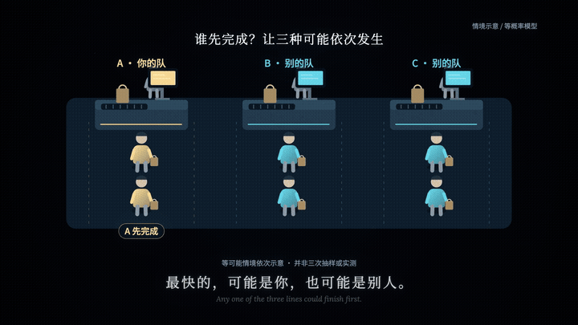

# Vibe 知识大赏 Skill

用代码制作知识科普短片：事实核查 → 文案分镜 → Canvas 动画 → 可选人声与单一 BGM → MP4。

适用于把概率、机制和因果过程演出来。核心原则是先展示具体物体的变化，再给术语、数字和结论。支持新片制作，也支持修改已有视频的配音或音乐。

## Demo：别的队

为什么总觉得别的队更快？这条 36 秒样片先演示三种队伍情境，再归纳 `1/3 → 2/3`。下方 GIF 展示中段动画，点击可打开完整 MP4。

[](demo/other-queue.mp4)

[▶ 观看完整 Demo（36 秒，1080p，含云扬解说）](demo/other-queue.mp4)

GitHub 演示版仅包含原创动画与合成解说，不含第三方 BGM。三队等可能最快且无并列是模型假设；画面是手工编排的情境示意，不是实测结果。

## 特点

- 确定性 Canvas 时间线，支持乱序 seek、静帧、转场拼图和并行渲染。
- 同一场景连续演变，通过主体动作、镜头尺度和结果归组讲解，避免整片只轮流高亮卡片。
- 默认可用 `zh-CN-YunyangNeural` 云扬男声，逐句合成并检查是否超出时间窗口。
- 显式管理音轨：一个 BGM、固定音乐增益，默认不随人声突然压低音乐；不混入旧视频声音或引擎底音。
- 输出 MP4、可修改工程、文案分镜、事实出处和混音检查报告。

## 安装

将本仓库克隆到 Codex 的 skill 目录：

```sh
git clone https://github.com/ilovetochangetheworld/vibevideo.git ~/.codex/skills/vibe-knowledge-video
```

如果同名目录已存在，先检查并保留自己的修改。安装后重新打开 Codex 会话以加载 skill。

需要 Python 3、FFmpeg / ffprobe 和 Google Chrome。建议在工作区创建虚拟环境：

```sh
python3 -m venv .venv
source .venv/bin/activate
python -m pip install -r ~/.codex/skills/vibe-knowledge-video/assets/requirements.txt
python ~/.codex/skills/vibe-knowledge-video/assets/engine/get_fonts.py
```

字体首次使用时从 Google Fonts 下载，并保留对应 OFL 许可；字体缓存不包含在仓库中。配音需要访问在线 Edge TTS 服务，音色可用性取决于服务返回。

## 在 Codex 中使用

```text
用 $vibe-knowledge-video 制作一条“为什么总觉得别的队更快”的知识短片。
先做约 30 秒样片，用云扬男声和我提供的单一 BGM。
先把队伍动作演出来，再推导数字；背景音乐保持稳定音量。
```

也可以请求修改现有工程：

```text
用 $vibe-knowledge-video 修改这个工程：让中间的三种情境在同一场景里连续演示，
保留当前配音和 BGM，输出新版 MP4 与对比预览。
```

入口为 [SKILL.md](SKILL.md)。详细说明：

- [讲解与画面](references/story-and-visuals.md)
- [配音与混音](references/audio.md)：`cues.json`、`mix.json` 格式与命令
- [引擎与渲染](references/engine.md)

新建脚本只生成空工程，代理仍需按选题创作文案和动画；不是无需创作即可批量出成片的模板。默认在本地交付，平台发布另行处理。

## 来源与许可

本仓库原创脚本和文档采用 [MIT License](LICENSE)。Canvas 引擎来自 [HeyChengC/vibe-knowledge-film](https://github.com/HeyChengC/vibe-knowledge-film)，基于提交 `62d51508aad00003dc6209afa80c4b5dc540de59`，保留 [上游原始许可](assets/engine/LICENSE)。渲染器包含本地资源队列、初始化报错及并行子进程退出处理的修正。

没有包含上游参考片、第三方歌曲或用户提供的音频；`demo/` 包含本项目原创动画与合成解说的演示视频。使用者自行提供可使用的配乐；代码许可不授予第三方媒体的使用权。字体各自遵循下载时保存的 OFL 许可。
